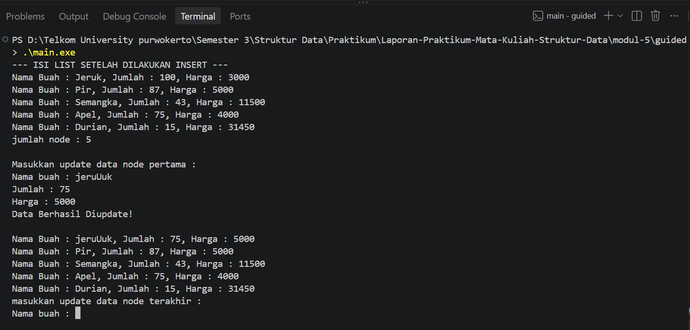
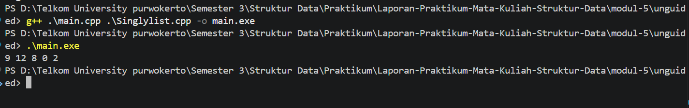
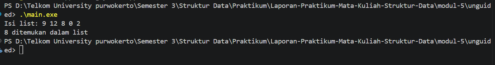
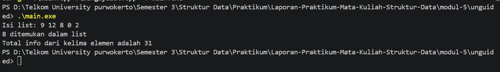

# <h1 align="center">Laporan Praktikum Modul 5 - Singly Linked List (Bagian Kedua): Searching dan Update</h1>
<p align="center">Adhara Faliya Utanti - 109082500033</p>

## Dasar Teori

Singly Linked List (SLL) merupakan struktur data yang terdiri dari node-node yang saling terhubung melalui pointer `next`. Setiap node menyimpan informasi dan alamat node berikutnya. Operasi pada SLL dilakukan dengan menelusuri node mulai dari `first` sampai ditemukan node yang dibutuhkan atau sampai pointer bernilai `Nil` [1].

### A. Searching pada Singly Linked List

#### 1. Pengertian Searching

Searching adalah operasi untuk mencari node tertentu di dalam linked list. Proses pencarian dilakukan dengan mengunjungi node satu per satu dari awal list. Pencarian berhenti ketika data yang dicari ditemukan atau ketika seluruh node sudah diperiksa tetapi data tersebut tidak ditemukan [1].

#### 2. Pencarian Berdasarkan Data

Pencarian berdasarkan data membandingkan nilai informasi pada setiap node dengan nilai yang dicari. Pada program praktikum, `FindNodeByData()` membandingkan nama buah pada `isidata.nama` dengan kata yang dimasukkan. Program juga menghitung posisi node agar lokasi data yang ditemukan dapat ditampilkan.

#### 3. Pencarian Berdasarkan Alamat Node

Pencarian berdasarkan alamat dilakukan dengan membandingkan alamat pointer setiap node dengan alamat node yang dicari. Fungsi `FindNodeByAddress()` menelusuri list dan memeriksa apakah pointer node yang sedang diperiksa sama dengan pointer tujuan. Jika cocok, program menampilkan posisi, alamat, dan isi node tersebut.

#### 4. Pencarian Berdasarkan Rentang Nilai

Pencarian berdasarkan rentang digunakan untuk menemukan semua node yang nilainya berada di antara batas awal dan batas akhir. Pada program praktikum, `FindNodeByRange()` memeriksa harga buah dengan kondisi `harga >= hargaAwal && harga <= hargaAkhir`. Karena setiap node diperiksa, hasilnya dapat memuat lebih dari satu node.

### B. Update pada Singly Linked List

#### 1. Pengertian Update

Update merupakan operasi untuk mengubah informasi pada node yang sudah ada tanpa menghapus node atau mengubah hubungan pointer antarnode. Pada program ini, data yang dapat diperbarui meliputi nama buah, jumlah, dan harga.

#### 2. Update Node Pertama dan Terakhir

`updateFirst()` mengubah informasi pada node yang ditunjuk oleh `first`. Sementara itu, `updateLast()` menelusuri list sampai node terakhir, kemudian meminta data baru untuk menggantikan informasi sebelumnya. Kedua operasi memeriksa apakah list kosong sebelum melakukan perubahan.

#### 3. Update Node Setelah Node Tertentu

`updateAfter()` memperbarui node yang berada tepat setelah node yang ditunjuk oleh parameter `nodePrev`. Program memeriksa apakah list tidak kosong dan apakah `nodePrev` serta node setelahnya valid. Jika valid, informasi pada node tujuan diganti, sedangkan hubungan antarnode tetap sama.

## Guided

Guided pada praktikum ini menggunakan tiga file yang diberikan, yaitu `listBuah.h`, `listBuah.cpp`, dan `main.cpp`. Program mengelola data buah yang terdiri dari nama, jumlah, dan harga, lalu menjalankan operasi update, searching, dan delete.

### 1. Header File — `listBuah.h`

```cpp
// Header guard mencegah file header di-include lebih dari sekali.
#ifndef LISTBUAH_H
#define LISTBUAH_H
#define Nil NULL

#include <iostream>
using namespace std;

struct buah {
    string nama;
    int jumlah;
    float harga;
};

typedef buah dataBuah;
typedef struct node *address;

struct node {
    dataBuah isidata;
    address next;
};

struct linkedlist {
    address first;
};

// Operasi dasar linked list
bool isEmpty(linkedlist List);
void createList(linkedlist &List);
address alokasi(string nama, int jumlah, float harga);
void dealokasi(address &node);
void printList(linkedlist List);
void insertFirst(linkedlist &List, address nodeBaru);
void insertAfter(linkedlist &List, address nodeBaru, address Prev);
void insertLast(linkedlist &List, address nodeBaru);
void delFirst(linkedlist &List);
void delLast(linkedlist &List);
void delAfter(linkedlist &List, address nodeHapus, address nodePrev);
int nbList(linkedlist List);
void deleteList(linkedlist &List);

// Operasi update
void updateFirst(linkedlist List);
void updateLast(linkedlist List);
void updateAfter(linkedlist List, address prev);

// Operasi searching
void FindNodeByData(linkedlist list, string data);
void FindNodeByAddress(linkedlist list, address node);
void FindNodeByRange(linkedlist list, float hargaAwal, float hargaAkhir);

#endif
```

**Penjelasan**

File `listBuah.h` mendefinisikan struktur data dan deklarasi fungsi yang akan digunakan pada program. `struct buah` menyimpan nama, jumlah, dan harga. Struktur `node` menyimpan data buah pada bagian `isidata` serta pointer `next`, sedangkan `linkedlist` memiliki pointer `first` sebagai penunjuk node pertama. Deklarasi `updateFirst()`, `updateLast()`, `updateAfter()`, dan tiga fungsi pencarian menjadi penghubung antara program utama dan implementasinya.

### 2. Implementasi — `listBuah.cpp`

```cpp
#include "listBuah.h"
#include <iostream>
using namespace std;

// Mengecek apakah list kosong
bool isEmpty(linkedlist List) {
    return List.first == Nil;
}

// Membuat list kosong
void createList(linkedlist &List) {
    List.first = Nil;
}

// Membuat node dan mengisi data buah
address alokasi(string nama, int jumlah, float harga) {
    address nodeBaru = new node;
    nodeBaru->isidata.nama = nama;
    nodeBaru->isidata.jumlah = jumlah;
    nodeBaru->isidata.harga = harga;
    nodeBaru->next = Nil;
    return nodeBaru;
}

// Membebaskan memori node
void dealokasi(address &nodeHapus) {
    if (nodeHapus != Nil) {
        nodeHapus->next = Nil;
        delete nodeHapus;
        nodeHapus = Nil;
    }
}

// Menambahkan node di awal list
void insertFirst(linkedlist &List, address nodeBaru) {
    nodeBaru->next = List.first;
    List.first = nodeBaru;
}

// Menambahkan node setelah node Prev
void insertAfter(linkedlist &List, address nodeBaru, address Prev) {
    if (Prev != Nil && nodeBaru != Nil) {
        nodeBaru->next = Prev->next;
        Prev->next = nodeBaru;
    } else {
        cout << "Node sebelumnya tidak valid!" << endl;
    }
}

// Menambahkan node di akhir list
void insertLast(linkedlist &List, address nodeBaru) {
    if (nodeBaru == Nil) return;

    if (isEmpty(List)) {
        List.first = nodeBaru;
    } else {
        address nodeBantu = List.first;
        while (nodeBantu->next != Nil) {
            nodeBantu = nodeBantu->next;
        }
        nodeBantu->next = nodeBaru;
    }
}

// Menghapus node pertama
void delFirst(linkedlist &List) {
    if (isEmpty(List)) {
        cout << "List kosong!" << endl;
        return;
    }

    address nodeHapus = List.first;
    List.first = nodeHapus->next;
    nodeHapus->next = Nil;
    dealokasi(nodeHapus);
    cout << "Node pertama berhasil terhapus!" << endl;
}

// Menghapus node terakhir
void delLast(linkedlist &List) {
    if (isEmpty(List)) {
        cout << "List kosong!" << endl;
        return;
    }

    address nodeHapus = List.first;

    if (nodeHapus->next == Nil) {
        List.first = Nil;
        dealokasi(nodeHapus);
    } else {
        address nodePrev = Nil;
        while (nodeHapus->next != Nil) {
            nodePrev = nodeHapus;
            nodeHapus = nodeHapus->next;
        }
        nodePrev->next = Nil;
        dealokasi(nodeHapus);
    }

    cout << "Node terakhir berhasil terhapus!" << endl;
}

// Menghapus node setelah nodePrev
void delAfter(linkedlist &List, address nodeHapus, address nodePrev) {
    if (isEmpty(List)) {
        cout << "List kosong!" << endl;
        return;
    }

    if (nodePrev != Nil && nodePrev->next != Nil) {
        nodeHapus = nodePrev->next;
        nodePrev->next = nodeHapus->next;
        nodeHapus->next = Nil;
        dealokasi(nodeHapus);
        cout << "Node setelah node " << nodePrev->isidata.nama
             << " berhasil terhapus!" << endl;
    } else {
        cout << "Node sebelumnya (prev) tidak valid!" << endl;
    }
}

// Menampilkan seluruh data buah
void printList(linkedlist List) {
    if (isEmpty(List)) {
        cout << "List kosong." << endl;
        return;
    }

    address nodeBantu = List.first;
    while (nodeBantu != Nil) {
        cout << "Nama Buah : " << nodeBantu->isidata.nama
             << ", Jumlah : " << nodeBantu->isidata.jumlah
             << ", Harga : " << nodeBantu->isidata.harga << endl;
        nodeBantu = nodeBantu->next;
    }
}

// Menghitung jumlah node
int nbList(linkedlist List) {
    int count = 0;
    address nodeBantu = List.first;
    while (nodeBantu != Nil) {
        count++;
        nodeBantu = nodeBantu->next;
    }
    return count;
}

// Menghapus semua node
void deleteList(linkedlist &List) {
    address nodeBantu = List.first;
    while (nodeBantu != Nil) {
        address nodeHapus = nodeBantu;
        nodeBantu = nodeBantu->next;
        dealokasi(nodeHapus);
    }
    List.first = Nil;
    cout << "List berhasil terhapus!" << endl;
}

// UPDATE: mengubah data pada node pertama
void updateFirst(linkedlist List) {
    if (isEmpty(List)) {
        cout << "List kosong!" << endl;
        return;
    }

    cout << "Masukkan update data node pertama:" << endl;
    cout << "Nama buah : ";
    cin >> List.first->isidata.nama;
    cout << "Jumlah : ";
    cin >> List.first->isidata.jumlah;
    cout << "Harga : ";
    cin >> List.first->isidata.harga;
    cout << "Data berhasil diupdate!" << endl << endl;
}

// UPDATE: mengubah data pada node terakhir
void updateLast(linkedlist List) {
    if (isEmpty(List)) {
        cout << "List kosong!" << endl;
        return;
    }

    address nodeBantu = List.first;
    while (nodeBantu->next != Nil) {
        nodeBantu = nodeBantu->next;
    }

    cout << "Masukkan update data node terakhir:" << endl;
    cout << "Nama buah : ";
    cin >> nodeBantu->isidata.nama;
    cout << "Jumlah : ";
    cin >> nodeBantu->isidata.jumlah;
    cout << "Harga : ";
    cin >> nodeBantu->isidata.harga;
    cout << "Data berhasil diupdate!" << endl << endl;
}

// UPDATE: mengubah data pada node setelah nodePrev
void updateAfter(linkedlist List, address nodePrev) {
    if (isEmpty(List)) {
        cout << "List kosong!" << endl;
        return;
    }

    if (nodePrev == Nil || nodePrev->next == Nil) {
        cout << "Node sebelumnya (prev) tidak valid!" << endl;
        return;
    }

    address nodeBantu = nodePrev->next;
    cout << "Masukkan update data node setelah node "
         << nodePrev->isidata.nama << ":" << endl;
    cout << "Nama buah : ";
    cin >> nodeBantu->isidata.nama;
    cout << "Jumlah : ";
    cin >> nodeBantu->isidata.jumlah;
    cout << "Harga : ";
    cin >> nodeBantu->isidata.harga;
    cout << "Data berhasil diupdate!" << endl << endl;
}

// SEARCHING: mencari node berdasarkan nama buah
void FindNodeByData(linkedlist list, string data) {
    if (isEmpty(list)) {
        cout << "List kosong!" << endl << endl;
        return;
    }

    address nodeBantu = list.first;
    int posisi = 0;
    bool found = false;

    while (nodeBantu != Nil) {
        posisi++;
        if (nodeBantu->isidata.nama == data) {
            cout << "Data " << data << " ditemukan pada posisi ke-"
                 << posisi << "!" << endl;
            cout << "Nama Buah : " << nodeBantu->isidata.nama
                 << ", Jumlah : " << nodeBantu->isidata.jumlah
                 << ", Harga : " << nodeBantu->isidata.harga << endl;
            found = true;
            break;
        }
        nodeBantu = nodeBantu->next;
    }

    if (!found) {
        cout << "Node dengan data " << data << " tidak ditemukan!" << endl;
    }
    cout << endl;
}

// SEARCHING: mencari node berdasarkan alamat pointer
void FindNodeByAddress(linkedlist list, address node) {
    if (isEmpty(list)) {
        cout << "List kosong!" << endl << endl;
        return;
    }

    address nodeBantu = list.first;
    int posisi = 0;
    bool found = false;

    while (nodeBantu != Nil) {
        posisi++;
        if (nodeBantu == node) {
            cout << "Node ditemukan pada posisi ke-" << posisi << "!" << endl;
            cout << "Alamat node : " << nodeBantu << endl;
            cout << "Nama Buah : " << nodeBantu->isidata.nama
                 << ", Jumlah : " << nodeBantu->isidata.jumlah
                 << ", Harga : " << nodeBantu->isidata.harga << endl;
            found = true;
            break;
        }
        nodeBantu = nodeBantu->next;
    }

    if (!found) {
        cout << "Node dengan alamat " << node
             << " tidak ditemukan dalam list!" << endl;
    }
    cout << endl;
}

// SEARCHING: mencari node dalam rentang harga
void FindNodeByRange(linkedlist list, float hargaAwal, float hargaAkhir) {
    if (isEmpty(list)) {
        cout << "List kosong!" << endl << endl;
        return;
    }

    address nodeBantu = list.first;
    int posisi = 0;
    bool found = false;

    cout << "--- Buah dalam range harga " << hargaAwal
         << " - " << hargaAkhir << " ---" << endl;
    cout << "-------------------------------------------" << endl;

    while (nodeBantu != Nil) {
        posisi++;
        float harga = nodeBantu->isidata.harga;

        if (harga >= hargaAwal && harga <= hargaAkhir) {
            cout << "Data ditemukan pada posisi ke-" << posisi << ":" << endl;
            cout << "Nama Buah : " << nodeBantu->isidata.nama
                 << ", Jumlah : " << nodeBantu->isidata.jumlah
                 << ", Harga : " << nodeBantu->isidata.harga << endl;
            cout << "-------------------------------------------" << endl;
            found = true;
        }
        nodeBantu = nodeBantu->next;
    }

    if (!found) {
        cout << "Tidak ada data buah dalam range harga tersebut!" << endl;
        cout << "-------------------------------------------" << endl;
    }
    cout << endl;
}
```

**Penjelasan**

File `listBuah.cpp` mengimplementasikan operasi dasar SLL serta fungsi update dan searching. Pada bagian update, program mengganti data buah pada node yang dituju tanpa mengubah pointer `next`. Pada bagian searching, program menelusuri list dari node pertama. `FindNodeByData()` mencari nama, `FindNodeByAddress()` mencari alamat node, dan `FindNodeByRange()` menampilkan seluruh buah dengan harga yang berada di dalam rentang yang ditentukan.

**Catatan penyesuaian:** kode di atas mempertahankan nama fungsi dan alur dari file praktikum yang diberikan. Beberapa pengamanan pointer ditambahkan pada operasi dealokasi dan penghapusan node terakhir agar pointer tidak dibiarkan menunjuk ke memori yang sudah dihapus.

### 3. Program Utama — `main.cpp`

```cpp
#include "listBuah.h"
#include <iostream>
using namespace std;

int main() {
    linkedlist List;
    address nodeA, nodeB, nodeC, nodeD, nodeE = Nil;
    createList(List);

    nodeA = alokasi("Jeruk", 100, 3000);
    nodeB = alokasi("Apel", 75, 4000);
    nodeC = alokasi("Pir", 87, 5000);
    nodeD = alokasi("Semangka", 43, 11500);
    nodeE = alokasi("Durian", 15, 31450);

    insertFirst(List, nodeA);
    insertLast(List, nodeB);
    insertAfter(List, nodeC, nodeA);
    insertAfter(List, nodeD, nodeC);
    insertLast(List, nodeE);

    cout << "--- ISI LIST SETELAH DILAKUKAN INSERT ---" << endl;
    printList(List);
    cout << "Jumlah node : " << nbList(List) << endl << endl;

    updateFirst(List);
    printList(List);

    updateLast(List);
    printList(List);

    updateAfter(List, nodeD);
    printList(List);

    cout << "--- ISI LIST SETELAH DILAKUKAN UPDATE ---" << endl;
    printList(List);
    cout << "Jumlah node : " << nbList(List) << endl << endl;

    FindNodeByData(List, "kelapa");
    FindNodeByAddress(List, nodeC);
    FindNodeByRange(List, 5000, 10000);

    delFirst(List);
    printList(List);
    delLast(List);
    printList(List);
    delAfter(List, nodeD, nodeC);
    printList(List);

    cout << "--- ISI LIST SETELAH DILAKUKAN DELETE ---" << endl;
    printList(List);
    cout << "Jumlah node : " << nbList(List) << endl << endl;

    deleteList(List);
    cout << "--- ISI LIST SETELAH DILAKUKAN HAPUS LIST ---" << endl;
    printList(List);
    cout << "Jumlah node : " << nbList(List) << endl;

    return 0;
}
```

**Penjelasan**

Program utama membuat lima node buah, yaitu Jeruk, Apel, Pir, Semangka, dan Durian. Node-node tersebut dimasukkan menggunakan `insertFirst()`, `insertLast()`, dan `insertAfter()`. Program lalu menguji update pada node pertama, node terakhir, dan node setelah Semangka. Setelah itu, program menjalankan tiga pencarian: berdasarkan nama `kelapa`, berdasarkan alamat node Pir, dan berdasarkan rentang harga 5.000 sampai 10.000. Terakhir, program menguji penghapusan node dan penghapusan seluruh list.

**Catatan saat menjalankan:** `updateFirst()`, `updateLast()`, dan `updateAfter()` meminta input dari pengguna. Nama buah dimasukkan tanpa spasi karena kode menggunakan `cin >>`. Hasil pencarian nama `kelapa` bergantung pada data yang dimasukkan saat proses update.

**Output Guided**


## Unguided

Bagian Unguided mengacu pada Modul 05 STRUKDAT.pdf, bagian 5.2 Latihan. Modul meminta pembuatan ADT SLL dengan tipe infotype berupa int, kemudian menampilkan data 9 12 8 0 2. Pada halaman 50, latihan dilanjutkan dengan pencarian nilai 8 dan perhitungan total seluruh elemen, yaitu 9 + 12 + 8 + 0 + 2 = 31

### 1. Soal 1 — Membuat ADT Singly Linked List dan Menampilkan Data

Soal pertama meminta pembuatan ADT Singly Linked List dengan `infotype` bertipe `int`, lalu menampilkan data `9 12 8 0 2` sesuai ilustrasi pada halaman 49 modul.

#### 1.1 Kode dasar — `Singlylist.h`

```cpp
#ifndef SINGLYLIST_H
#define SINGLYLIST_H
#define Nil NULL

#include <iostream>
using namespace std;

typedef int infotype;
typedef struct ElmList *address;

struct ElmList {
    infotype info;
    address next;
};

struct List {
    address first;
};

void CreateList(List &L);
address alokasi(infotype x);
void dealokasi(address &P);
void printInfo(List L);
void insertFirst(List &L, address P);

#endif
```

**Penjelasan:** File header mendefinisikan tipe data `infotype`, pointer `address`, struktur node `ElmList`, dan struktur `List`. File ini juga mendeklarasikan fungsi untuk membuat list, mengalokasikan dan membebaskan node, menampilkan data, serta menambahkan node di awal list.

#### 1.2 Kode dasar — `Singlylist.cpp`

```cpp
#include "Singlylist.h"
#include <iostream>
using namespace std;

void CreateList(List &L) {
    L.first = Nil;
}

address alokasi(infotype x) {
    address P = new ElmList;
    P->info = x;
    P->next = Nil;
    return P;
}

void dealokasi(address &P) {
    if (P != Nil) {
        P->next = Nil;
        delete P;
        P = Nil;
    }
}

void printInfo(List L) {
    address P = L.first;

    while (P != Nil) {
        cout << P->info;
        if (P->next != Nil) {
            cout << " ";
        }
        P = P->next;
    }
    cout << endl;
}

void insertFirst(List &L, address P) {
    if (P == Nil) return;
    P->next = L.first;
    L.first = P;
}
```

**Penjelasan:** File implementasi berisi definisi fungsi yang dideklarasikan pada header. `CreateList()` membuat list kosong, `alokasi()` membuat node baru, `dealokasi()` membebaskan memori, `insertFirst()` menambahkan node di depan, dan `printInfo()` menampilkan isi list dari awal hingga akhir.

#### 1.3 Kode dasar — `main.cpp`

```cpp
#include "Singlylist.h"
#include <iostream>
using namespace std;

int main() {
    List L;
    address P1, P2, P3, P4, P5;
    CreateList(L);

    P1 = alokasi(2);
    insertFirst(L, P1);

    P2 = alokasi(0);
    insertFirst(L, P2);

    P3 = alokasi(8);
    insertFirst(L, P3);

    P4 = alokasi(12);
    insertFirst(L, P4);

    P5 = alokasi(9);
    insertFirst(L, P5);

    printInfo(L);

    // Membebaskan seluruh node sebelum program selesai
    while (L.first != Nil) {
        address hapus = L.first;
        L.first = L.first->next;
        dealokasi(hapus);
    }

    return 0;
}
```

**Penjelasan:** Program membuat lima node berisi `2`, `0`, `8`, `12`, dan `9`. Karena setiap node dimasukkan dengan `insertFirst()`, nilai yang dimasukkan belakangan akan berada di depan. Hasil akhirnya adalah `9 12 8 0 2`. Bagian akhir program membebaskan seluruh node yang telah dibuat.

#### Output Soal 1


### 2. Soal 2 — Mencari Elemen dengan Nilai 8

Soal kedua meminta penambahan fungsi `findElm(L, x)` yang mengembalikan alamat node jika nilai yang dicari ditemukan dan mengembalikan `Nil` jika nilai tersebut tidak ada di dalam list.

#### 2.1 Tambahan kode untuk Soal 2

**Tambahan pada `Singlylist.h`**

Tambahan deklarasi sebelum `#endif`:

```cpp
address findElm(List L, infotype x);
```

**Tambahan pada `Singlylist.cpp`**

Tambahan fungsi setelah implementasi `insertFirst()`:

```cpp
address findElm(List L, infotype x) {
    address P = L.first;

    while (P != Nil) {
        if (P->info == x) {
            return P;
        }
        P = P->next;
    }

    return Nil;
}
```

**Tambahan pada `main.cpp`**

Setelah pemanggilan `printInfo(L);`, terdapat tambahan pada pengujian berikut:

```cpp
address hasil = findElm(L, 8);

if (hasil != Nil) {
    cout << hasil->info << " ditemukan dalam list" << endl;
} else {
    cout << "Data tidak ditemukan dalam list" << endl;
}
```

**Penjelasan tambahan kode:** `findElm()` memeriksa setiap node mulai dari `L.first`. Jika `P->info` sama dengan nilai yang dicari, fungsi mengembalikan pointer `P`. Jika sampai akhir list tidak ditemukan kecocokan, fungsi mengembalikan `Nil`.

#### 2.2 Kode lengkap

Kode di bawah ini merupakan **hasil penggabungan seluruh kode Soal 1 dengan tambahan fungsi pencarian dari Soal 2**.

**`Singlylist.h`**

```cpp
#ifndef SINGLYLIST_H
#define SINGLYLIST_H
#define Nil NULL

#include <iostream>
using namespace std;

typedef int infotype;
typedef struct ElmList *address;

struct ElmList {
    infotype info;
    address next;
};

struct List {
    address first;
};

void CreateList(List &L);
address alokasi(infotype x);
void dealokasi(address &P);
void printInfo(List L);
void insertFirst(List &L, address P);
address findElm(List L, infotype x);

#endif
```

**`Singlylist.cpp`**

```cpp
#include "Singlylist.h"
#include <iostream>
using namespace std;

void CreateList(List &L) {
    L.first = Nil;
}

address alokasi(infotype x) {
    address P = new ElmList;
    P->info = x;
    P->next = Nil;
    return P;
}

void dealokasi(address &P) {
    if (P != Nil) {
        P->next = Nil;
        delete P;
        P = Nil;
    }
}

void printInfo(List L) {
    address P = L.first;

    while (P != Nil) {
        cout << P->info;
        if (P->next != Nil) {
            cout << " ";
        }
        P = P->next;
    }
    cout << endl;
}

void insertFirst(List &L, address P) {
    if (P == Nil) return;
    P->next = L.first;
    L.first = P;
}

address findElm(List L, infotype x) {
    address P = L.first;

    while (P != Nil) {
        if (P->info == x) {
            return P;
        }
        P = P->next;
    }

    return Nil;
}
```

**`main.cpp`**

```cpp
#include "Singlylist.h"
#include <iostream>
using namespace std;

int main() {
    List L;
    address P1, P2, P3, P4, P5;
    CreateList(L);

    P1 = alokasi(2);
    insertFirst(L, P1);

    P2 = alokasi(0);
    insertFirst(L, P2);

    P3 = alokasi(8);
    insertFirst(L, P3);

    P4 = alokasi(12);
    insertFirst(L, P4);

    P5 = alokasi(9);
    insertFirst(L, P5);

    cout << "Isi list: ";
    printInfo(L);

    address hasil = findElm(L, 8);
    if (hasil != Nil) {
        cout << hasil->info << " ditemukan dalam list" << endl;
    } else {
        cout << "Data tidak ditemukan dalam list" << endl;
    }

    while (L.first != Nil) {
        address hapus = L.first;
        L.first = L.first->next;
        dealokasi(hapus);
    }

    return 0;
}
```

#### Output Soal 2


**Penjelasan Soal 2:** List tetap berisi `9 12 8 0 2`. Fungsi `findElm()` berhasil menemukan node dengan nilai `8`, kemudian program menampilkan pesan bahwa nilai tersebut ditemukan. Jika nilai yang dicari tidak ada, program akan menampilkan pesan bahwa data tidak ditemukan.

### 3. Soal 3 — Menghitung Total Nilai Seluruh Elemen

Soal ketiga meminta program menghitung total seluruh nilai di dalam list. Sesuai modul, perhitungannya adalah `9 + 12 + 8 + 0 + 2 = 31`.

#### 3.1 Tambahan kode untuk Soal 3

**Tambahan pada `Singlylist.h`**

Terdapat penambahan deklarasi sebelum `#endif`:

```cpp
int totalInfo(List L);
```

**Tambahan pada `Singlylist.cpp`**

Menambahkan fungsi berikut setelah implementasi `findElm()`:

```cpp
int totalInfo(List L) {
    int total = 0;
    address P = L.first;

    while (P != Nil) {
        total += P->info;
        P = P->next;
    }

    return total;
}
```

**Tambahan pada `main.cpp`**

Setelah kode pencarian nilai `8`, menambahkan:

```cpp
cout << "Total info dari kelima elemen adalah "
     << totalInfo(L) << endl;
```

**Penjelasan tambahan kode:** `totalInfo()` menelusuri semua node dan menjumlahkan setiap nilai `info` ke variabel `total`. Setelah seluruh node diperiksa, fungsi mengembalikan hasil penjumlahan.

#### 3.2 Kode lengkap

Bagian ini merupakan **versi akhir gabungan seluruh latihan**. Ketiga file berikut sudah memuat ADT dasar, pencarian nilai, dan perhitungan total nilai.

**`Singlylist.h`**

```cpp
#ifndef SINGLYLIST_H
#define SINGLYLIST_H
#define Nil NULL

#include <iostream>
using namespace std;

typedef int infotype;
typedef struct ElmList *address;

struct ElmList {
    infotype info;
    address next;
};

struct List {
    address first;
};

void CreateList(List &L);
address alokasi(infotype x);
void dealokasi(address &P);
void printInfo(List L);
void insertFirst(List &L, address P);
address findElm(List L, infotype x);
int totalInfo(List L);

#endif
```

**`Singlylist.cpp`**

```cpp
#include "Singlylist.h"
#include <iostream>
using namespace std;

void CreateList(List &L) {
    L.first = Nil;
}

address alokasi(infotype x) {
    address P = new ElmList;
    P->info = x;
    P->next = Nil;
    return P;
}

void dealokasi(address &P) {
    if (P != Nil) {
        P->next = Nil;
        delete P;
        P = Nil;
    }
}

void printInfo(List L) {
    address P = L.first;

    while (P != Nil) {
        cout << P->info;
        if (P->next != Nil) {
            cout << " ";
        }
        P = P->next;
    }
    cout << endl;
}

void insertFirst(List &L, address P) {
    if (P == Nil) return;
    P->next = L.first;
    L.first = P;
}

address findElm(List L, infotype x) {
    address P = L.first;

    while (P != Nil) {
        if (P->info == x) {
            return P;
        }
        P = P->next;
    }

    return Nil;
}

int totalInfo(List L) {
    int total = 0;
    address P = L.first;

    while (P != Nil) {
        total += P->info;
        P = P->next;
    }

    return total;
}
```

**`main.cpp`**

```cpp
#include "Singlylist.h"
#include <iostream>
using namespace std;

int main() {
    List L;
    address P1, P2, P3, P4, P5;
    CreateList(L);

    P1 = alokasi(2);
    insertFirst(L, P1);

    P2 = alokasi(0);
    insertFirst(L, P2);

    P3 = alokasi(8);
    insertFirst(L, P3);

    P4 = alokasi(12);
    insertFirst(L, P4);

    P5 = alokasi(9);
    insertFirst(L, P5);

    cout << "Isi list: ";
    printInfo(L);

    address hasil = findElm(L, 8);
    if (hasil != Nil) {
        cout << hasil->info << " ditemukan dalam list" << endl;
    } else {
        cout << "Data tidak ditemukan dalam list" << endl;
    }

    cout << "Total info dari kelima elemen adalah "
         << totalInfo(L) << endl;

    while (L.first != Nil) {
        address hapus = L.first;
        L.first = L.first->next;
        dealokasi(hapus);
    }

    return 0;
}
```

#### Output Soal 3 — Program Gabungan Akhir


**Penjelasan Soal 3:** Setelah fungsi `findElm()` dari Soal 2 tersedia, fungsi `totalInfo()` ditambahkan untuk menjumlahkan nilai semua node. Program akhir tetap menampilkan isi list, memeriksa keberadaan nilai `8`, lalu menghitung total semua nilai. Hasil akhirnya adalah `31`, sesuai dengan contoh pada halaman 50 modul.

## Kesimpulan

Praktikum Modul 5 membahas operasi searching dan update pada Singly Linked List. Searching dilakukan dengan menelusuri node satu per satu, baik untuk mencari data tertentu, alamat node, maupun nilai dalam rentang tertentu. Update digunakan untuk mengubah informasi pada node pertama, node terakhir, atau node setelah node tertentu tanpa mengubah susunan pointer list. Pada bagian Unguided, fungsi `findElm()` berhasil digunakan untuk mencari nilai `8`, sedangkan fungsi `totalInfo()` menghitung jumlah seluruh elemen dan menghasilkan nilai `31`. Praktikum ini memperkuat pemahaman tentang penggunaan pointer, penelusuran node, dan pengolahan data pada struktur SLL.

## Referensi

[1] Triase. (2020). *Diktat Edisi Revisi: Struktur Data*. Medan: Universitas Islam Negeri Sumatera Utara Medan. Modul 5, “Singly Linked List (Bagian Kedua),” khususnya bagian 5.1 Searching dan 5.2 Latihan, hlm. 47–50.

[2] Indahyati, U., & Rahmawati, Y. (2020). *Buku Ajar Algoritma dan Pemrograman dalam Bahasa C++*. Umsida Press. https://doi.org/10.21070/2020/978-623-6833-67-4
